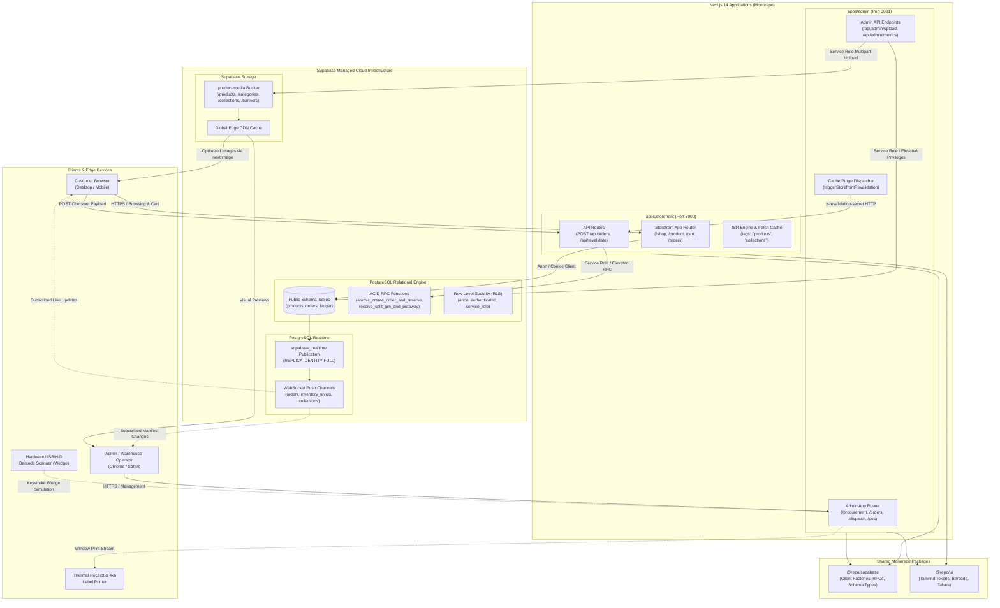
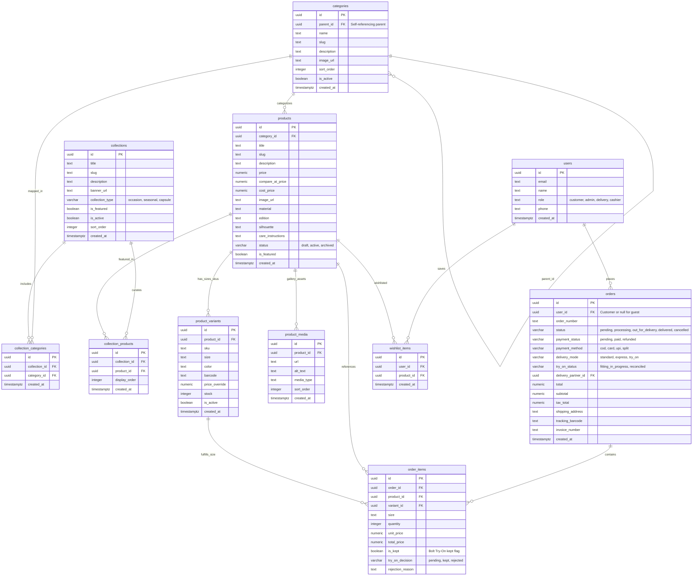
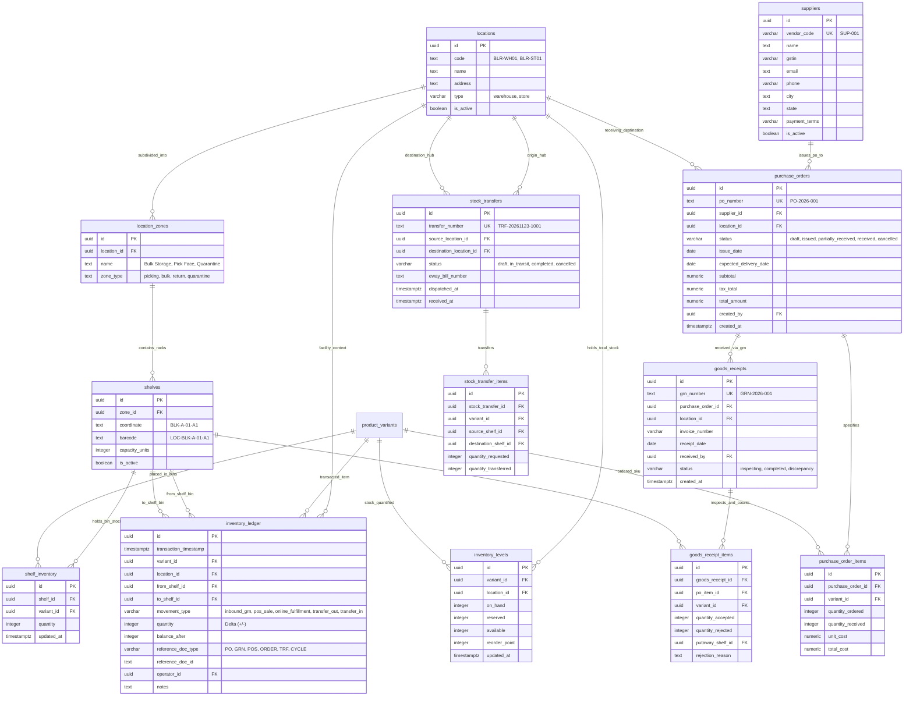
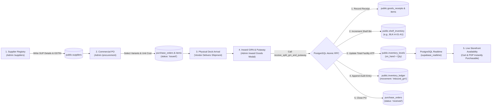
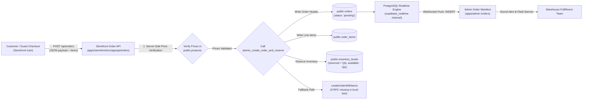
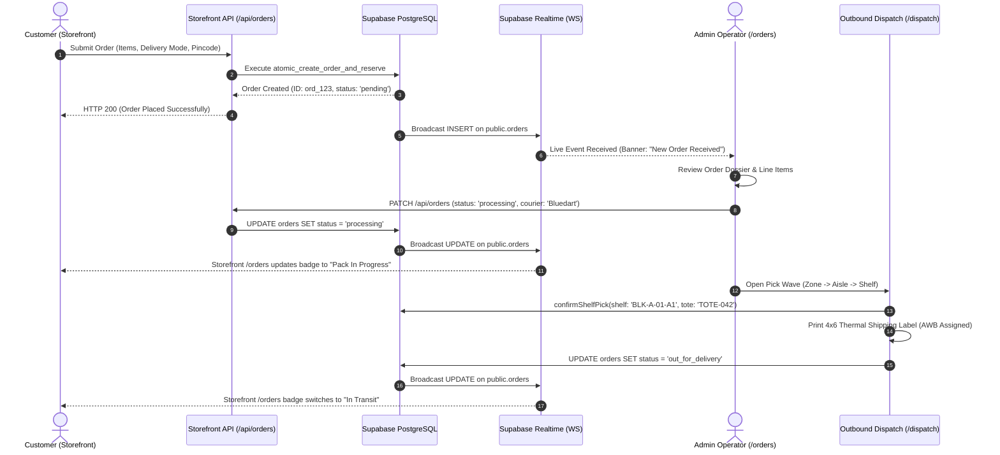
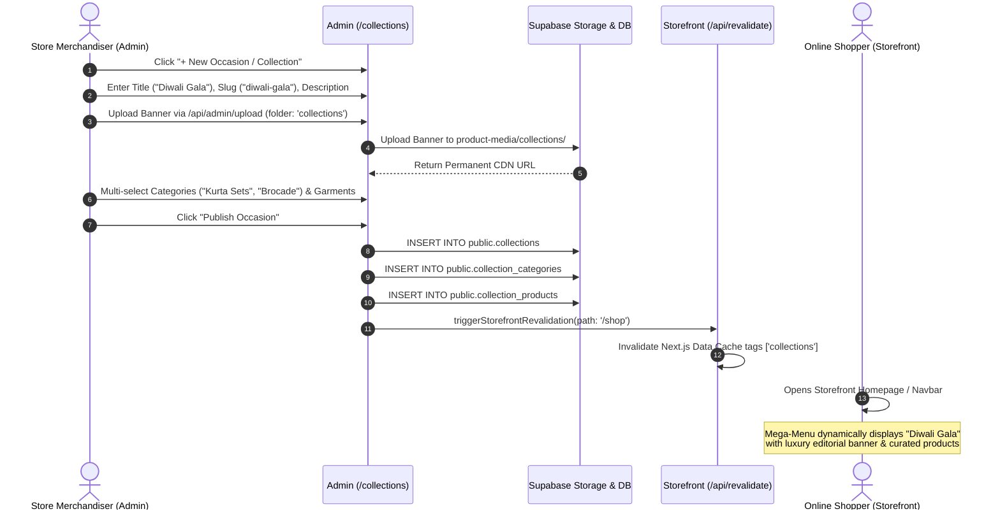
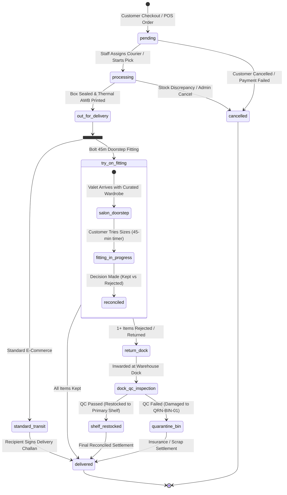
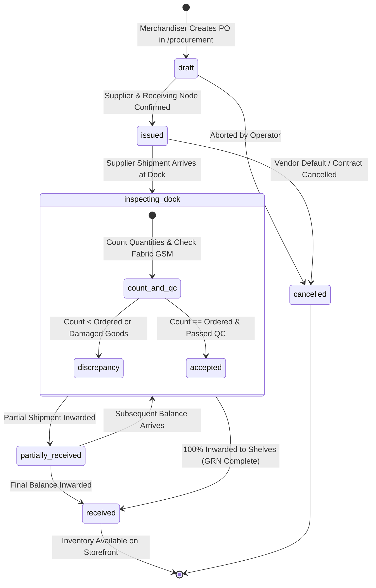

# ATELIER — Visual Architecture, Database Blueprint & Operations Manual

---

## Executive Summary

**Atelier** is an enterprise-grade omnichannel luxury fashion platform built on a modern TypeScript monorepo architecture. It seamlessly unifies:
1. **High-Performance Consumer Storefront (`apps/storefront`)**: Next.js 14 App Router, Incremental Static Regeneration (ISR), luxury editorial aesthetics, Doorstep Try-On (Bolt 45m), and omnichannel checkout.
2. **Operations & WMS/OMS Admin Portal (`apps/admin`)**: Real-time warehouse fulfillment, bin-directed pick waves, physical barcode wedge scanner integration, purchase orders, goods receipts (GRN), inter-store stock transfers, and boutique POS cash register.
3. **Unified Supabase Architecture (`packages/supabase`)**: PostgreSQL relational engine, double-entry inventory ledger, Row-Level Security (RLS), atomic RPC transactions, PostgreSQL Realtime (`supabase_realtime`), and Supabase Storage with dedicated bucket partitions.
4. **Shared Component System (`packages/ui`)**: High-contrast, theme-aware luxury design tokens, Code 128 barcode rendering, print modals, and accessible interactive primitives.

---

# Part 1: Visual Architecture & System Blueprints

---

### 1. High-Level System & Monorepo Architecture

---

### 2. Full Entity Relationship Diagrams (ERDs)

#### ERD (A) — Catalog, Collections & Omnichannel Orders

---

#### ERD (B) — WMS, Procurement, Inventory Topology & Audit Ledger

---

### 3. End-to-End Data Flow Diagrams (DFD)

#### DFD 1 — Inbound Supply Chain Flow (Vendor to Live Stock)

---

#### DFD 2 — Omnichannel Order Placement & Stock Reservation Flow

---

#### DFD 3 — Unified Media Upload Pipeline

```mermaid
flowchart LR
    AdminForm["Admin Form UI<br/>(Products / Categories / CMS)"] -->|"Drop JPEG, PNG, WebP, AVIF"| ClientValidate["Client Guardrails<br/>(File size < 10 MB)"]
    ClientValidate -->|"POST /api/admin/upload<br/>multipart/form-data"| UploadRoute["Upload API Route<br/>(apps/admin/src/app/api/admin/upload)"]
    
    UploadRoute -->|"1. Validate MIME Type"| MimeCheck{"Allowed MIME?<br/>(JPEG, PNG, WebP, AVIF)"}
    MimeCheck -->|No| RejectMime["HTTP 400: Invalid MIME"]
    MimeCheck -->|Yes| SizeCheck{"Size <= 10 MB?"}
    SizeCheck -->|No| RejectSize["HTTP 400: Over 10 MB"]
    
    SizeCheck -->|Yes| FolderPartition["Partition Folder<br/>(/products, /categories, /collections, /banners)"]
    FolderPartition --> GenUUID["Generate Clean Path<br/>folder/timestamp-random-slug.ext"]
    
    GenUUID --> StorageUpload["supabase.storage.from('product-media')<br/>.upload(path, buffer)"]
    StorageUpload --> GenURL["supabase.storage.getPublicUrl(path)"]
    
    GenURL -->|"Permanent Public CDN URL"| DBUpdate[("PostgreSQL DB Table<br/>(products.image_url / categories.image_url)")]
    DBUpdate --> PurgeISR["triggerStorefrontRevalidation()"]
    PurgeISR --> StorefrontCDN["Storefront next/image<br/>(Instant Cache Invalidation & Delivery)"]
```

---

### 4. Sequence Diagrams

#### Sequence 1 — Real-Time Order Lifecycle & Cross-App Sync

---

#### Sequence 2 — Occasions & Collections Publishing Flow

---

### 5. State Machine Diagrams

#### Order Status State Machine (Including Bolt 45m Doorstep Try-On)

---

#### Purchase Order & GRN Inbound State Machine

---

# Part 2: Complete Operations Manual

---

## Section 1: Admin Panel Runbook (`apps/admin`)

### 1. Initial Setup: Facility Topology, Categories & Occasions

#### A. Multi-Facility Warehouse & Store Locations
- **Where to go:** `Sidebar → Inventory & WMS → Locations & Shelves` (`/locations`).
- **What to do:**
  1. Verify the active location selector in the top-right toolbar or sidebar header (e.g. `BLR-WH01 — Atelier Central Mother Hub` or `BLR-ST01 — Indiranagar Flagship Boutique`).
  2. Inspect Zones: Bulk Storage (`bulk`), Pick Face (`picking`), Returns Dock (`return`), and Quarantine (`quarantine`).
  3. Ensure physical shelf coordinates (e.g. `BLK-A-01-A1`, `QRN-BIN-01`) have barcodes generated.

#### B. Hierarchical Product Categories
- **Where to go:** `Sidebar → Catalog & CMS → Categories` (`/categories`).
- **What to do:**
  1. Click **`+ Add Category`** to open the creation drawer.
  2. Enter **Category Name** (e.g., `Anarkali Sets`), **Slug** (`anarkali-sets`), and optional **Parent Category** for nested subcategories (e.g., `Womenswear → Festive Sets → Anarkali Sets`).
  3. Upload an editorial high-resolution category thumbnail (PNG/WebP/JPEG up to 10 MB) via the upload dropzone. The image is uploaded through `/api/admin/upload` to `product-media/categories/`.
  4. Click **`Save Category`**. Next.js on-demand revalidation immediately synchronizes the storefront menu.

#### C. Collections & Occasions
- **Where to go:** `Sidebar → Catalog & CMS → Collections & Occasions` (`/collections`).
- **What to do:**
  1. Click **`+ New Occasion / Collection`**.
  2. Provide **Title** (e.g., `Royal Weddings`), **Slug** (`royal-weddings`), **Occasion Group Type** (`occasion`, `seasonal`, or `capsule`), and a brief editorial brief.
  3. Upload a wide landscape banner image (via `/api/admin/upload` to `product-media/collections/`).
  4. Tag participating categories and garments.
  5. Toggle **`Published`** and click **`Publish Occasion`**. The collection will immediately show in the Storefront navbar mega-menu and `/shop?collection=royal-weddings`.

---

### 2. Catalog Management: Launching Garments & Variants

- **Where to go:** `Sidebar → Inventory & WMS → Inventory Matrix` (`/inventory`) → Click **`Launch Garment`** (`/inventory/new`).
- **Step-by-step garment launch:**
  1. **Garment Provenance:** Enter Title (e.g., `Raw Silk Angrakha Kurti`), Category, Silhouette, Fabric & GSM specification (e.g., `450 GSM Pure Mulberry Silk`), and Care Instructions.
  2. **Edition / Drop Tag:** Specify limited batch tag (e.g., `Strict Edition // 120 Pieces`).
  3. **Editorial Imagery:** Drag and drop product photos. The upload route automatically stores them in `product-media/products/` and returns public URLs.
  4. **Size & SKU Matrix:** Specify sizes (`XS`, `S`, `M`, `L`, `XL`, `XXL`), assign unique SKUs (e.g., `KURTI-ANG-M`), initial launch stock, and optional size price overrides.
  5. Click **`Launch Garment into Catalog`**. The garment is written to `public.products`, variants to `public.product_variants`, and on-demand cache revalidation triggers automatically.

---

### 3. Inbound Supply Chain Operations (Supplier → PO → GRN → Live Stock)

Follow this exact 3-step workflow to register vendors, purchase inventory, and receive stock onto shelves:

#### Step 1: Register Supplier Vendor
- **Route:** `Sidebar → Supply Chain → Suppliers` (`/suppliers`).
- **Action:** Click **`+ Add Supplier`**.
- **Fields:** Vendor Name (e.g., `Bengaluru Loom Crafts`), Vendor Code (`SUP-0042`), GSTIN (15-character alphanumeric GST format, e.g. `29AABCU9603R1ZM`), Contact Person, Email, Phone, Address, City, State, State Code (`29` for Karnataka), and Payment Terms (`Net 30`).
- **Commit:** Click **`Save Supplier Vendor`**. Persists to `public.suppliers`.

#### Step 2: Issue Commercial Purchase Order (PO)
- **Route:** `Sidebar → Supply Chain → Purchase Orders & GRN` (`/procurement`).
- **Action:** Click **`+ Issue Purchase Order`**.
- **Drawer Controls:**
  1. Select **Supplier Vendor** from dropdown.
  2. Select **Default Receiving Node** (e.g., `BLR-WH01 — Atelier Central Mother Hub`).
  3. Set **Expected Delivery Date**.
  4. **Omnisearch & Quick-Add Products:** Use the search bar to filter by garment title, SKU, size, material, or category. Click any variant card to add it to the PO.
  5. Set **Ordered Quantity** and negotiated wholesale **Cost Price (₹)**.
  6. The system calculates Subtotal, 12% GST Tax, and Grand Total.
  7. Click **`Commit & Issue PO`**. The PO is recorded in `public.purchase_orders` with status `issued`.

#### Step 3: Inward Goods Receipt (GRN) & Shelf Putaway
- **Route:** `Sidebar → Supply Chain → Purchase Orders & GRN` (`/procurement`).
- **Action:** Locate the issued PO in the table and click **`Inward GRN & Putaway`**.
- **Inspection Modal:**
  1. Enter vendor Invoice Number and Delivery Challan Reference.
  2. For each SKU, enter **Accepted Quantity** and **Putaway Shelf Coordinate** (e.g., `BLK-A-01-A1`).
  3. If any garments are defective, enter **Rejected Quantity** and Rejection Reason (e.g., `Torn seam during transit`).
  4. Click **`Commit Goods Receipt & Putaway`**.
- **System Verification:**
  - `public.goods_receipts` logs the receipt.
  - `public.shelf_inventory` increments the bin count at `BLK-A-01-A1`.
  - `public.inventory_levels` increments the facility on-hand ATP stock.
  - `public.inventory_ledger` writes a permanent `inbound_grn` audit transaction with document reference `GRN-XXXX`.
  - The variant immediately becomes purchasable on the Storefront.

---

### 4. Order Fulfillment Runbook

- **Where to go:** `Sidebar → Operations → Orders` (`/orders`) and `Sidebar → Operations → Outbound Dispatch` (`/dispatch`).
- **Order Lifecycle Steps:**
  1. **New Order Alert:** The green `Realtime Sync: Connected` badge notifies staff of new incoming orders.
  2. **Assign Courier:** In `/orders`, select a delivery courier from the dropdown. Status automatically updates to `processing`.
  3. **Pick Wave Execution:** In `/dispatch` → `Pick Waves` tab, follow the bin-directed sequence. Scan the shelf barcode (`LOC-BLK-A-01-A1`) or garment barcode to verify the pick into tote `TOTE-042`.
  4. **Packing Station:** In `/dispatch` → `Packing Station` tab, enter package weight (`1.25 kg`), package dimensions, and carrier AWB code (`BD-XXXXX`). Click **`Print Shipping Label (4x6)`** to print the thermal parcel label.
  5. **Seal & Dispatch:** Click **`Complete Packing & Seal Box`**. Order transitions to `out_for_delivery`.
  6. **Doorstep Try-On (Bolt 45m):**
     - Customer receives fitting at doorstep.
     - Kept items are reconciled; rejected garments return to dock via `/dispatch` → `Try-On Dock Inwarding`.
     - Passed items restock to primary shelf; damaged items divert to `QRN-BIN-01`.

---

### 5. CMS & Storefront Merchandising

- **Where to go:** `Sidebar → Catalog & CMS → Storefront CMS` (`/cms`).
- **Operational Tabs:**
  1. **Announcement Bar:** Update marquee announcement text, discount coupon codes, link destination, and toggle visibility.
  2. **Hero Carousel:** Add, reorder, or edit homepage full-screen hero slides with editorial images, couture titles, and CTA links.
  3. **Homepage Sections:** Arrange grid blocks (`Hero Carousel`, `Shop by Category`, `Curated Occasions`, `Editor's Picks`, `Brand Heritage`).
  4. **Tokens Studio:** Fine-tune theme typography, letter-spacing, and gold/chrome color accents.
  5. **Commit:** Click **`Publish & Revalidate Storefront`** to purge edge caches instantly.

---

### 6. Admin Module Feature Matrix

| Module / Route | Exact Sidebar Path | What It Actually Does | Implementation Status |
| :--- | :--- | :--- | :--- |
| **Dashboard** | `Operations → Dashboard` (`/dashboard`) | Executive KPI overview: Today's GMV, active order count, low stock count, channel distribution. | **Working End-to-End** |
| **POS Terminal** | `Operations → POS Terminal` (`/pos`) | Omnichannel cash register: Barcode scanner input, product catalog, split payments (Cash, Card, UPI), parked carts, shift float management, BORIS returns, thermal receipt printer. | **Working End-to-End** |
| **Orders** | `Operations → Orders` (`/orders`) | Omnichannel order manifest: Realtime incoming alerts, channel filtering, status state machine, courier assignment, GST invoice generation. | **Working End-to-End** |
| **Outbound Dispatch** | `Operations → Outbound Dispatch` (`/dispatch`) | Fulfillment terminal: Bin-directed pick waves with barcode wedge scanning, packing station with 4x6 thermal shipping labels, Bolt try-on returns inwarding with QC quarantine. | **Working End-to-End** |
| **Bolt Try-On** | `Operations → Bolt Try-On` (`/bolt`) | Hyperlocal 45-min doorstep try-on management: Pincode serviceability mapping, hub proximity, delivery timeslots. | **Working End-to-End** |
| **Inventory Matrix** | `Inventory & WMS → Inventory Matrix` (`/inventory`) | Omnichannel stock grid: Multi-location Available-To-Promise (ATP) inventory, category filtering, search, low-stock warnings. | **Working End-to-End** |
| **Locations & Shelves** | `Inventory & WMS → Locations & Shelves` (`/locations`) | Physical WMS topology: Warehouse and boutique hubs, zone assignment (bulk, picking, quarantine), shelf coordinate barcodes. | **Working End-to-End** |
| **Stock Transfers** | `Inventory & WMS → Stock Transfers` (`/inventory/transfers`) | Inter-facility transfer state machine: Source/dest locations, SKU selection, E-Way bill generation, dispatch, receiving verification. | **Working End-to-End** |
| **Audit Ledger** | `Inventory & WMS → Audit Ledger` (`/inventory/ledger`) | Double-entry append-only immutable journal: Transaction timestamp, movement type, delta ($\Delta$), post balance, reference documents. | **Working End-to-End** |
| **Purchase Orders & GRN** | `Supply Chain → Purchase Orders & GRN` (`/procurement`) | Commercial procurement: Vendor linkage, product omnisearch, PO generation, goods receipt dock inwarding, automatic putaway into shelf inventory. | **Working End-to-End** |
| **Suppliers** | `Supply Chain → Suppliers` (`/suppliers`) | Vendor master directory: GSTIN tracking, lead times, contact details, payment terms, active toggle. | **Working End-to-End** |
| **Categories** | `Catalog & CMS → Categories` (`/categories`) | Category tree: Parent/child nested taxonomy, image upload via `/api/admin/upload`, revalidation trigger. | **Working End-to-End** |
| **Collections & Occasions**| `Catalog & CMS → Collections & Occasions` (`/collections`) | Occasion merchandising: Festive and seasonal curation, multi-category and product mapping, banner upload. | **Working End-to-End** |
| **Barcode Studio** | `Catalog & CMS → Barcode Studio` (`/barcodes`) | Barcode generation: Code 128 label printing for product variants and physical warehouse shelf locations. | **Working End-to-End** |
| **Customers & Staff** | `Catalog & CMS → Customers & Staff` (`/customers`) | Role-based user directory: Customers, store cashiers, warehouse managers, delivery couriers. | **Working End-to-End** |
| **Storefront CMS** | `Catalog & CMS → Storefront CMS` (`/cms`) | Merchandising command center: Marquee announcement bar, hero banners, section reordering, visual design tokens. | **Working End-to-End** |

---

## Section 2: Storefront Runbook (`apps/storefront`)

### 1. Customer Shopping Journey
1. **Discovery & Navigation:**
   - **Navbar Mega-Menu:** Displays live categories and curated occasions (e.g. *Festivals*, *Weddings*, *Workwear*) with visual banners.
   - **`/shop` Page:** High-speed server-rendered catalog with filters for Category, Occasion Collection, Price Range, and In-Stock availability.
2. **Product Detail Page (PDP):**
   - High-resolution zoomable editorial gallery.
   - Interactive size selector (`XS`, `S`, `M`, `L`, `XL`) displaying real-time stock levels.
   - Fabric, GSM, and provenance narrative tabs.
   - Wishlist toggle and Add-to-Cart drawer.
3. **Delivery Modes:**
   - **Standard Express Delivery:** Direct doorstep shipment via courier.
   - **Bolt 45-Minute Try-On:** Customer enters pincode; if serviceable, can select a 45-minute fitting timeslot where a valet brings multiple sizes to their door.
4. **Checkout (Authenticated or Guest):**
   - Supports registered patrons (profile sync) and guest checkouts.
   - Server-side price verification rejects any tampered client prices.
   - Atomic reservation RPC guarantees stock cannot be oversold.

### 2. Live Customer Order Tracking
- **Route:** Storefront `/orders` or `/orders?reference=ORD-XXXX`.
- **Experience:**
  - Realtime subscription listens for status updates from Admin or Delivery couriers.
  - Status badges update dynamically: `Pending` → `Pack In Progress` → `In Transit` → `Delivered`.
  - For Bolt Doorstep Try-On, customers view real-time fitting progress and reconciled kept items.

---

*Manual maintained by Atelier Engineering Team. All rights reserved.*
